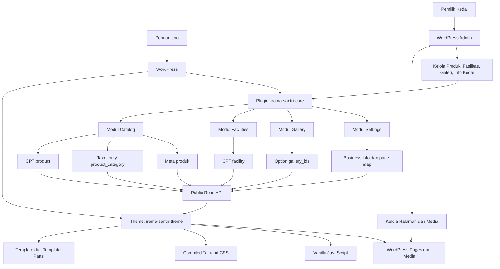
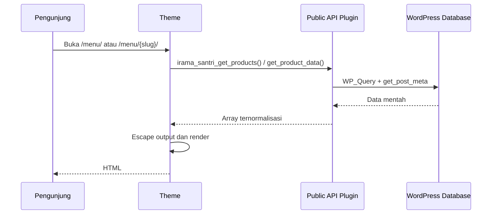
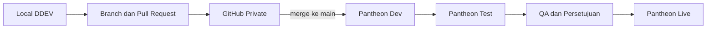

# TECHNICAL ARCHITECTURE — WEBSITE KEDAI KOPI IRAMA SANTRI

**Versi:** 1.1  
**Status:** Draft — siap review  
**Berdasarkan:** `BRIEF.md` 1.0 dan `PRD.md` 1.0  
**Terakhir diperbarui:** 3 November 2026  
**Bahasa:** Indonesia

---

## 0. Hasil Pemeriksaan dan Perubahan Versi 1.1

Dokumen 1.0 diperiksa silang terhadap `BRIEF.md` dan `PRD.md`. Temuan berikut sudah diperbaiki:

| # | Temuan pada 1.0 | Dampak | Perbaikan pada 1.1 |
|---|---|---|---|
| 1 | Nama theme tidak konsisten: `irama-santri` vs `irama-santri-theme` | Kebingungan struktur dan deployment | Nama resmi: **`irama-santri-theme`** |
| 2 | Plugin hanya dijelaskan untuk produk, padahal PRD membutuhkan fasilitas, galeri, dan info kedai | Tidak ada pemilik data untuk tiga kebutuhan tersebut | Satu plugin modular **`irama-santri-core`** dengan modul Catalog, Facilities, Gallery, Settings |
| 3 | Tidak ada kontrak baca antara Theme dan Plugin | Theme berisiko membaca format meta mentah | Ditetapkan public read API berprefiks `irama_santri_*` (§7) |
| 4 | Lokasi `package.json` berbeda antara Architecture dan PRD | Build Tailwind tidak jelas | `package.json` di root repository; output CSS di Theme |
| 5 | Struktur repository belum memuat `inc/`, `src/`, dan aset hasil build | Scaffold tidak dapat dijalankan | Struktur final diperbarui (§10) |
| 6 | `single-product.php` dan `archive-product.php` ambigu | URL katalog tidak pasti | Menu memakai WordPress Page; produk memakai single `/menu/{slug}`; arsip CPT tidak diaktifkan |
| 7 | Integrasi GitHub–Pantheon terdengar otomatis | Risiko deployment gagal | Ditetapkan dua remote dan langkah verifikasi (§12) |
| 8 | Tidak ada baseline PHP/WordPress | Risiko kompatibilitas | PHP 8.2+, WordPress 6.5+; versi final mengikuti Pantheon |
| 9 | Tidak ada perilaku saat plugin nonaktif | Theme berpotensi fatal error | Aturan degradasi eksplisit (§15) |
| 10 | Tidak ada target aksesibilitas | Kualitas frontend tidak terukur | Target WCAG 2.1 AA (§14) |
| 11 | Kepemilikan data galeri, fasilitas, dan info kedai tidak jelas | Data bisa tersimpan di Theme | Ditetapkan sebagai CPT/option milik plugin (§8) |
| 12 | Strategi editor tidak diputuskan | Risiko page builder dan data tidak konsisten | Classic Theme dengan field terstruktur; tanpa page builder (§11) |

Ruang lingkup produk tidak berubah. Dokumen ini tidak menambah fitur di luar `BRIEF.md` dan `PRD.md`.

---

## 1. Tujuan Dokumen

Dokumen ini menjelaskan rancangan arsitektur teknis Website Kedai Kopi Irama Santri sebelum implementasi fitur.

Arsitektur ini menjadi acuan untuk:

- memisahkan tanggung jawab WordPress Core, Custom Theme, dan Custom Plugin;
- memastikan data katalog dan konten terstruktur tidak bergantung pada Theme;
- menetapkan kontrak data antara Theme dan Plugin;
- menetapkan struktur repository, proses build, dan alur deployment;
- menjadi dasar `DATABASE.md`, `DEVELOPMENT.md`, dan `AGENTS.md`;
- mencegah keputusan implementasi yang menyimpang dari ruang lingkup.

---

## 2. Ruang Lingkup Arsitektur

### Termasuk

- WordPress sebagai CMS.
- Classic Custom Theme untuk presentasi.
- Satu Custom Plugin modular untuk data dan logika konten terstruktur.
- Tailwind CSS yang dikompilasi untuk produksi.
- Vanilla JavaScript untuk interaksi kecil.
- Pengembangan lokal dengan DDEV.
- Version control Git dengan remote GitHub private.
- Deployment ke Pantheon melalui Dev → Test → Live.

### Tidak Termasuk

- Online ordering, cart, checkout, dan pembayaran.
- Akun pelanggan dan database pelanggan.
- Formulir kontak, newsletter, WhatsApp, dan integrasi media sosial.
- Google Maps atau peta interaktif.
- Blog, Journal, Community & Events.
- Page builder atau editor layout bebas.
- REST API publik untuk transaksi.
- Automated end-to-end testing pada versi pertama.

---

## 3. Prinsip Arsitektur

1. **Theme bertanggung jawab atas presentasi.** Layout, template, navigasi, komponen UI, dan styling.
2. **Plugin bertanggung jawab atas data dan aturan konten terstruktur.** Produk, kategori, fasilitas, galeri, dan info kedai.
3. **WordPress Core menjadi fondasi CMS.** Pengguna, media, routing, database abstraction, dan dashboard.
4. **Data tidak boleh bergantung pada Theme.** Mengganti Theme tidak boleh menghilangkan atau mengubah data.
5. **Theme hanya membaca data melalui public API Plugin.** Theme tidak membaca meta mentah secara langsung.
6. **Tailwind dikompilasi.** Tailwind Play CDN tidak digunakan di lingkungan mana pun yang dibagikan.
7. **Aset produksi ikut di-commit.** Pantheon tidak menjalankan build Node saat deploy.
8. **Tidak ada page builder.** Struktur halaman dikendalikan Theme; konten diedit melalui field yang disediakan.
9. **Pengembangan bertahap.** Local → Dev → Test → Live, dengan verifikasi pada setiap lingkungan.
10. **Ruang lingkup dijaga.** Fitur baru memerlukan persetujuan terpisah.

---

## 4. Ringkasan Arsitektur



**Aturan arah dependensi:** Theme bergantung pada API Plugin, bukan sebaliknya. Plugin tidak boleh memanggil fungsi Theme.

---

## 5. Komponen dan Tanggung Jawab

### 5.1 WordPress Core

Bertanggung jawab atas:

- autentikasi dan role pengguna;
- Media Library;
- Pages dan konten umum;
- permalink dan routing;
- database abstraction dan API WordPress;
- dashboard admin.

Tidak ada login pelanggan, akun pengunjung, atau database pelanggan.

### 5.2 Custom Theme — `irama-santri-theme`

Bertanggung jawab atas:

- struktur visual seluruh halaman;
- header, navigasi, footer, dan komponen UI;
- template Homepage, About, Menu, Detail Menu, Our Space, Gallery, Contact & Location;
- responsive layout desktop dan mobile;
- styling Tailwind hasil kompilasi;
- SEO on-page dasar pada markup;
- aksesibilitas dasar dan semantic HTML;
- enqueue aset frontend;
- menampilkan empty state bila Plugin tidak aktif atau data kosong.

Tidak bertanggung jawab atas:

- registrasi CPT, taxonomy, atau meta;
- menyimpan harga, varian, add-on, fasilitas, galeri, atau info kedai;
- aturan validasi data;
- struktur data yang harus bertahan saat Theme diganti.

### 5.3 Custom Plugin — `irama-santri-core`

Nama pada PRD 1.0 adalah `irama-santri-catalog` dan bersifat sementara. Nama `irama-santri-core` dipilih karena tanggung jawabnya mencakup lebih dari katalog produk. Perubahan ini dicatat sebagai keputusan ADR-02.

Plugin terdiri dari modul yang saling independen:

| Modul | Tanggung jawab |
|---|---|
| `catalog` | CPT `product`, taxonomy `product_category`, meta produk, aturan harga, validasi varian/add-on |
| `facilities` | CPT `facility`, foto, deskripsi, urutan tampilan |
| `gallery` | Daftar attachment ID galeri dan urutannya |
| `settings` | Info kedai (alamat, jam operasional), pemetaan halaman (Menu, Contact) |
| `template-api` | Public read API yang dipakai Theme |

Plugin tidak bertanggung jawab atas desain visual. Plugin juga tidak boleh bergantung pada Theme.

### 5.4 Tailwind CSS dan JavaScript

- Tailwind CSS digunakan sebagai utility-first styling.
- Source CSS berada di `wp-content/themes/irama-santri-theme/src/css/app.css`.
- Build menghasilkan `wp-content/themes/irama-santri-theme/assets/css/app.css`.
- File hasil build **di-commit** karena Pantheon tidak menjalankan Node saat deploy.
- JavaScript hanya untuk interaksi kecil, ditulis vanilla tanpa bundler pada versi pertama.
- Interaksi yang direncanakan: toggle navigasi mobile, pengelolaan field admin, pemilih galeri.
- Konfigurasi lengkap ada di `DEVELOPMENT.md`.

### 5.5 Pantheon

Pantheon menjadi hosting dan lingkungan deployment:

1. Local — pengembangan.
2. Dev — integrasi.
3. Test — pengujian sebelum rilis.
4. Live — produksi.

Konfigurasi domain, SSL, caching, backup, dan sinkronisasi Git harus diverifikasi saat site dibuat. Integrasi GitHub–Pantheon tidak boleh diasumsikan tersedia sebelum diperiksa.

### 5.6 GitHub Private

Digunakan untuk:

- version control;
- riwayat perubahan;
- branching dan review;
- backup kode sumber.

Repository tidak boleh berisi:

- password, token API, atau secret;
- file konfigurasi lokal dengan kredensial;
- backup database produksi;
- file upload Media Library;
- `node_modules/` dan dependency build lainnya.

---

## 6. Batas Tanggung Jawab

| Fitur / data | Theme | Plugin Core | WordPress Core |
|---|---:|---:|---:|
| Header, footer, navigasi | Ya | Tidak | Fondasi |
| Layout dan responsive UI | Ya | Tidak | Tidak |
| Template halaman umum | Ya | Tidak | Menyediakan Pages |
| CPT `product` | Tidak | Ya | API registrasi |
| Taxonomy `product_category` | Tidak | Ya | API taxonomy |
| Harga produk | Menampilkan | Menyimpan/mengelola | Metadata API |
| Varian dan add-on | Menampilkan | Menyimpan/mengelola | Metadata API |
| Status ketersediaan | Menampilkan | Menyimpan/mengelola | Metadata API |
| Featured produk | Menampilkan | Menyimpan/mengelola | Metadata API |
| Foto produk | Menampilkan | Mengaitkan ID media | Media Library |
| CPT `facility` | Menampilkan | Ya | API registrasi |
| Urutan galeri | Menampilkan | Menyimpan/mengelola | Media Library |
| Alamat dan jam operasional | Menampilkan | Menyimpan/mengelola | Options API |
| Pemetaan halaman CTA | Tidak | Menyimpan/mengelola | Pages |
| Akun admin | Tidak | Tidak | Ya |
| Build CSS | Ya | Tidak | Tidak |
| Penyimpanan data | Tidak langsung | Melalui API WordPress | Database |

---

## 7. Kontrak Theme–Plugin

Theme hanya boleh membaca data melalui fungsi publik berikut. Semua fungsi berada di plugin dan aman dipanggil setelah `plugins_loaded`.

### 7.1 Fungsi Katalog

```php
irama_santri_get_products( array $args = array() ): WP_Query
irama_santri_get_featured_products( int $limit = 4 ): WP_Query
irama_santri_get_product_data( int $post_id ): array
irama_santri_get_variants( int $post_id ): array
irama_santri_get_addons( int $post_id ): array
irama_santri_get_price_range( int $post_id ): array
irama_santri_format_price( int $amount ): string
irama_santri_is_available( int $post_id ): bool
```

### 7.2 Fungsi Konten Kedai

```php
irama_santri_get_facilities( array $args = array() ): WP_Query
irama_santri_get_gallery_ids(): int[]
irama_santri_get_business_info(): array
irama_santri_get_page_url( string $key ): string
```

`$key` yang didukung: `menu`, `contact`.

### 7.3 Bentuk Data yang Dikembalikan

`irama_santri_get_product_data()` mengembalikan array ternormalisasi:

```php
array(
    'id'            => 123,
    'name'          => 'Latte',
    'permalink'     => 'https://kopisantrie.com/menu/latte/',
    'description'   => 'Deskripsi lengkap...',
    'excerpt'       => 'Deskripsi singkat...',
    'thumbnail_id'  => 45,
    'category_ids'  => array( 3 ),
    'base_price'    => 18000,
    'variants'      => array(
        array( 'label' => 'Regular', 'price' => 18000 ),
        array( 'label' => 'Large', 'price' => 22000 ),
    ),
    'addons'        => array(
        array( 'label' => 'Extra Shot', 'price' => 5000 ),
    ),
    'price_min'     => 18000,
    'price_max'     => 22000,
    'has_variants'  => true,
    'is_available'  => true,
    'is_featured'   => false,
    'order'         => 0,
)
```

### 7.4 Aturan Kontrak

- Theme tidak membaca `_is_*` atau option secara langsung.
- Plugin tidak memanggil fungsi Theme.
- Theme wajib mengecek `function_exists()` untuk setiap fungsi Plugin.
- Jika Plugin tidak aktif, Theme menampilkan empty state, bukan fatal error.
- Perubahan bentuk data wajib memperbarui `DATABASE.md` dan fungsi API.

---

## 8. Model Data Ringkas

Detail lengkap ada di `DATABASE.md`.

| Data | Penyimpanan | Pemilik |
|---|---|---|
| Produk | CPT `product` | Plugin — modul Catalog |
| Kategori produk | Taxonomy `product_category` | Plugin — modul Catalog |
| Harga dasar | Post meta `_is_base_price` (integer rupiah) | Plugin — modul Catalog |
| Varian | Post meta `_is_variants` (JSON array) | Plugin — modul Catalog |
| Add-on | Post meta `_is_addons` (JSON array) | Plugin — modul Catalog |
| Ketersediaan | Post meta `_is_available` (boolean) | Plugin — modul Catalog |
| Featured | Post meta `_is_featured` (boolean) | Plugin — modul Catalog |
| Urutan produk | `menu_order` | Plugin — modul Catalog |
| Fasilitas | CPT `facility` | Plugin — modul Facilities |
| Galeri | Option `irama_santri_gallery_ids` (array attachment ID) | Plugin — modul Gallery |
| Alamat dan jam | Option `irama_santri_business_info` (array) | Plugin — modul Settings |
| Pemetaan halaman | Option `irama_santri_page_map` (array page ID) | Plugin — modul Settings |

Harga disimpan sebagai integer rupiah, bukan string berformat. Format rupiah hanya diterapkan saat render.

---

## 9. Alur Data

### 9.1 Alur Baca Katalog



### 9.2 Alur Tulis Admin

1. Pemilik masuk ke WordPress Admin.
2. Pemilik membuka Produk, Fasilitas, Galeri, atau Info Kedai.
3. Plugin memeriksa capability dan nonce.
4. Plugin memvalidasi dan menyanitasi input.
5. Plugin menyimpan melalui API WordPress (`update_post_meta`, `update_option`).
6. Plugin membersihkan cache halaman bila diperlukan.
7. Theme menampilkan data terbaru melalui Public API.

### 9.3 Alur Galeri

1. Pemilik memilih foto dari Media Library.
2. Plugin menyimpan urutan attachment ID pada option `irama_santri_gallery_ids`.
3. Theme memanggil `irama_santri_get_gallery_ids()`.
4. Theme merender gambar dengan `wp_get_attachment_image()` dan ukuran yang terdaftar.

### 9.4 Aturan Tampilan Harga

- Tanpa varian: tampilkan `Rp {base_price}`.
- Dengan varian: tampilkan `Mulai dari Rp {price_min}` pada kartu; daftar harga varian pada halaman detail.
- Add-on ditampilkan terpisah dari harga produk.
- Harga `0` atau belum diisi: tampilkan `Harga belum tersedia`, bukan `Rp 0`.
- Status tidak tersedia tetap ditampilkan sebagai badge; produk tidak disembunyikan.

### 9.5 Aturan Featured

- Homepage menampilkan maksimal 4 produk featured yang tersedia.
- Jika tidak ada produk featured, homepage tidak menampilkan bagian featured (bukan menampilkan produk acak).
- Urutan featured mengikuti `menu_order`, lalu judul.

---

## 10. Struktur Repository

```text
kopisantrie/
├── AGENTS.md
├── README.md
├── .editorconfig
├── .gitignore
├── .ddev/
│   └── config.yaml
├── package.json
├── package-lock.json
├── docs/
│   ├── BRIEF.md
│   ├── PRD.md
│   ├── ARCHITECTURE.md
│   ├── DATABASE.md
│   ├── DEVELOPMENT.md
│   └── CODING-STANDARDS.md        (menyusul)
└── wp-content/
    ├── themes/
    │   └── irama-santri-theme/
    │       ├── style.css
    │       ├── functions.php
    │       ├── index.php
    │       ├── header.php
    │       ├── footer.php
    │       ├── inc/
    │       │   ├── setup.php
    │       │   ├── enqueue.php
    │       │   ├── plugin-compat.php
    │       │   └── template-tags.php
    │       ├── template-parts/
    │       ├── src/
    │       │   └── css/
    │       │       └── app.css
    │       └── assets/
    │           ├── css/
    │           │   └── app.css       (hasil build, di-commit)
    │           ├── js/
    │           │   └── navigation.js
    │           └── images/
    └── plugins/
        └── irama-santri-core/
            ├── irama-santri-core.php
            ├── uninstall.php
            ├── readme.txt
            ├── includes/
            │   ├── helpers.php
            │   ├── post-types.php
            │   ├── taxonomies.php
            │   ├── meta.php
            │   ├── options.php
            │   ├── template-functions.php
            │   └── admin.php
            └── assets/
                ├── css/
                └── js/
                    └── admin-repeaters.js
```

**Catatan:**

- WordPress core tidak disimpan dalam scaffold repository ini. Saat site Pantheon dibuat, repository akan digabung dengan upstream Pantheon yang menyediakan core.
- `wp-content/uploads/` tidak masuk Git.
- Folder `template-parts/` dan aset gambar akan diisi pada tahap implementasi desain.
- `docs/CODING-STANDARDS.md` menyusul sebelum implementasi fitur.

---

## 11. Strategi Editor dan Template

### 11.1 Keputusan: Classic Theme

Theme menggunakan **classic theme** berbasis PHP template, bukan block theme.

Alasan:

- Struktur halaman sudah ditentukan dan tidak membutuhkan editor layout bebas.
- Pemilik kedai tidak perlu mengelola blok atau pola.
- Tailwind lebih mudah diterapkan pada markup PHP yang terkontrol.
- Data katalog tetap dikelola melalui field terstruktur, bukan di dalam konten halaman.
- Lebih sedikit lapisan yang perlu dipelajari dan dirawat.

Konsekuensi:

- Konten halaman umum diedit melalui editor klasik WordPress.
- Layout tidak dapat diubah dari dashboard.
- Perubahan struktur halaman memerlukan perubahan Theme.

### 11.2 URL dan Template

| Halaman | URL | Sumber |
|---|---|---|
| Homepage | `/` | Page yang ditetapkan sebagai front page |
| About | `/about/` | Page |
| Menu | `/menu/` | Page dengan template `page-menu.php` |
| Detail produk | `/menu/{product-slug}/` | Single CPT `product` |
| Our Space | `/our-space/` | Page |
| Gallery | `/gallery/` | Page |
| Contact & Location | `/contact/` | Page |

Keputusan:

- CPT `product` memakai `rewrite.slug = menu`, `has_archive = false`.
- Halaman Menu adalah WordPress Page, bukan arsip CPT.
- Taxonomy `product_category` tidak memiliki arsip publik pada versi pertama. Kategori ditampilkan sebagai section pada halaman Menu untuk menghindari konten duplikat.
- Potensi konflik rewrite antara Page `menu` dan single product harus diuji pada tahap implementasi.

### 11.3 Dashboard Admin

- Menu utama: **Irama Santri** (Info Kedai, Galeri).
- Menu Produk dan Kategori Produk dikelola oleh CPT/taxonomy.
- Menu Fasilitas dikelola oleh CPT `facility`.
- Label menggunakan Bahasa Indonesia.
- Menu yang tidak dipakai (Posts, Comments) disembunyikan untuk menyederhanakan dashboard.
- Field teknis yang tidak diperlukan pemilik tidak ditampilkan.

---

## 12. Build dan Aset

| Aset | Source | Output | Cara |
|---|---|---|---|
| CSS | `theme/src/css/app.css` | `theme/assets/css/app.css` | Tailwind CLI, minify |
| JavaScript | `theme/assets/js/*.js` | sama | Tanpa bundler |
| Gambar | Media Library | `wp-content/uploads/` | Tidak di-commit |

Perintah:

```bash
npm ci
npm run dev      # watch
npm run build    # produksi, minify
```

Aturan:

- `npm run build` wajib dijalankan sebelum commit yang mengubah class Tailwind atau template.
- Output build di-commit.
- `node_modules/` tidak di-commit.
- Tailwind Play CDN dilarang.
- Token desain final menunggu persetujuan design system; nilai sementara ditandai di source CSS.

---

## 13. Environment dan Deployment

### 13.1 Matriks Environment

| Environment | Tujuan | Database | Media | Build CSS |
|---|---|---|---|---|
| Local | Pengembangan | DDEV | Lokal | Ya |
| Dev | Integrasi | Pantheon | Sync dari Live/Local | Dari Git |
| Test | QA dan persetujuan | Pantheon | Sync dari Live | Dari Git |
| Live | Produksi | Pantheon | Sumber utama | Dari Git |

### 13.2 Alur Deployment



Prinsip:

- Pekerjaan dilakukan di branch, bukan langsung di `main`.
- Pull request digunakan untuk review perubahan.
- `main` harus selalu dalam kondisi dapat dideploy.
- Promosi Dev → Test → Live dilakukan melalui mekanisme Pantheon, bukan dengan push langsung ke branch produksi.
- Database dan media tidak diperlakukan sama dengan source code. Sinkronisasi mengikuti mekanisme Pantheon.

### 13.3 Remote Git

Rencana:

- `origin` → GitHub private.
- `pantheon` → Pantheon Git remote untuk site yang sama.

Verifikasi yang diperlukan saat site dibuat:

1. Apakah plan Pantheon mendukung integrasi GitHub.
2. Apakah struktur repository Pantheon memerlukan core di dalam repo.
3. Apakah push ke `pantheon` menimpa file core atau hanya `wp-content`.
4. Bagaimana promosi Test dan Live dilakukan pada plan tersebut.

Sampai verifikasi selesai, deployment tidak boleh dianggap otomatis.

### 13.4 Rahasia dan Konfigurasi

- Kredensial lokal disimpan di konfigurasi DDEV atau `.env` yang tidak di-commit.
- Kredensial produksi disimpan di dashboard Pantheon, bukan di repository.
- `wp-config.php` tidak boleh memuat secret yang di-commit.
- File `.env`, `auth.json`, dan key privat masuk `.gitignore`.

---

## 14. Keamanan, Performa, SEO, dan Aksesibilitas

### 14.1 Keamanan

- HTTPS/SSL pada semua lingkungan publik.
- Administrator hanya untuk pemilik yang berwenang.
- Password kuat dan autentikasi dua faktor bila tersedia.
- Validasi dan sanitasi semua input.
- Escape output sesuai konteks.
- Nonce dan pemeriksaan capability untuk aksi admin.
- Gunakan API WordPress dan prepared query; hindari query mentah.
- Nonaktifkan editor file (`DISALLOW_FILE_EDIT`) di produksi.
- Batasi percobaan login.
- Perbarui WordPress, Theme, dan Plugin secara terkontrol.
- Backup mingguan dan sebelum perubahan besar; uji restore.
- Jangan menyimpan secret di repository.

### 14.2 Performa

- CSS hasil kompilasi Tailwind, diminifikasi.
- JavaScript minimal dan di-defer.
- Gambar teroptimasi, WebP/AVIF bila sesuai.
- Lazy loading untuk gambar non-kritis.
- Dimensi gambar ditentukan untuk mengurangi layout shift.
- Ukuran gambar terdaftar: `product-card`, `product-detail`, `gallery-thumb`.
- Caching mengikuti Pantheon Global CDN.
- Hindari plugin yang tidak diperlukan.
- Uji Lighthouse pada desktop dan mobile; tidak menjanjikan skor sebelum pengujian.

### 14.3 SEO

- Title dan meta description per halaman.
- Hierarki heading H1–H3 yang benar.
- Semantic HTML.
- Permalink ramah mesin pencari.
- XML sitemap dan robots.txt.
- Alt text wajib untuk gambar konten.
- Internal linking dasar.
- Tidak ada schema markup khusus pada versi pertama.

### 14.4 Aksesibilitas

Target: **WCAG 2.1 AA** untuk halaman utama.

- Skip link.
- Navigasi keyboard.
- Fokus terlihat.
- Kontras teks memadai.
- Alt text untuk gambar informatif; alt kosong untuk gambar dekoratif.
- Form admin memiliki label.
- Mendukung `prefers-reduced-motion`.
- Tidak mengandalkan warna saja untuk menyampaikan status.

---

## 15. Perilaku Degradasi dan Kegagalan

| Kondisi | Perilaku yang diwajibkan |
|---|---|
| Plugin nonaktif | Theme tetap render; section katalog menampilkan empty state; tidak ada fatal error |
| Belum ada produk | Halaman Menu menampilkan pesan "Menu belum tersedia" |
| Produk tanpa foto | Gunakan placeholder Theme, bukan gambar rusak |
| Harga belum diisi | Tampilkan "Harga belum tersedia", bukan `Rp 0` |
| Varian kosong | Jangan tampilkan blok varian |
| Add-on kosong | Jangan tampilkan blok add-on |
| Galeri kosong | Sembunyikan grid galeri |
| Halaman CTA belum dipetakan | CTA mengarah ke `home_url()` dan dicatat sebagai tugas admin |
| Theme diganti | Data produk, fasilitas, galeri, dan info kedai tetap ada |
| Plugin dihapus | Data tidak dihapus kecuali konstanta khusus diaktifkan |
| Gambar dihapus dari Media Library | Theme melewati attachment yang tidak valid |

---

## 16. Keputusan Arsitektur (ADR)

| ID | Keputusan | Alasan | Alternatif yang ditolak |
|---|---|---|---|
| ADR-01 | Classic Theme berbasis PHP | Kontrol markup dan Tailwind; tidak perlu page builder | Block theme, page builder |
| ADR-02 | Satu plugin modular `irama-santri-core` | Semua data terstruktur dalam satu tempat; menghindari dua plugin kecil | Dua plugin terpisah, data di Theme |
| ADR-03 | Data melalui CPT, taxonomy, meta, dan option | Memanfaatkan API WordPress; data bertahan saat Theme diganti | Tabel kustom, JSON di file Theme |
| ADR-04 | Public read API berprefiks | Theme tidak bergantung pada format meta mentah | Theme membaca meta langsung |
| ADR-05 | Tanpa Composer untuk runtime plugin | Tidak ada dependency eksternal; deploy Pantheon sederhana | Composer autoload, framework PHP |
| ADR-06 | Harga integer rupiah | Menghindari error pembulatan dan format | Float, string berformat |
| ADR-07 | Varian dan add-on sebagai JSON tervalidasi | Struktur fleksibel untuk jumlah baris tak terbatas | Tabel relasional, serialized PHP |
| ADR-08 | Output CSS di-commit | Pantheon tidak menjalankan build Node | Build saat deploy |
| ADR-09 | Menu sebagai WordPress Page | Pemilik dapat mengedit intro; menghindari duplikasi arsip | Arsip CPT `product` |
| ADR-10 | Tanpa arsip taxonomy publik | Menghindari konten duplikat dan URL tambahan | Arsip kategori |
| ADR-11 | Galeri sebagai urutan attachment ID | Memanfaatkan Media Library | CPT galeri, plugin galeri eksternal |
| ADR-12 | Info kedai sebagai option array | Data tunggal, mudah diedit | CPT pengaturan, hardcode di Theme |
| ADR-13 | Bahasa kode Inggris, UI Indonesia | Konsistensi teknis dan kenyamanan pemilik | Kode berbahasa Indonesia |
| ADR-14 | Tanpa automated E2E pada v1 | Skala situs kecil; QA manual terstruktur | Cypress/Playwright |

---

## 17. Risiko dan Verifikasi

| Risiko | Dampak | Mitigasi |
|---|---|---|
| WordPress belum dibuat di Pantheon | Deployment tidak dapat diuji | Buat site sebelum integrasi |
| Struktur upstream Pantheon belum diverifikasi | Konflik layout repository | Verifikasi sebelum push pertama |
| Integrasi GitHub–Pantheon tidak tersedia di plan | Alur deployment berubah | Konfirmasi plan; siapkan push manual |
| Domain dan DNS belum diarahkan | Site belum dapat diakses publik | Verifikasi saat site dibuat |
| Konflik rewrite Page `menu` dan single product | Detail produk 404 | Uji permalink pada tahap implementasi |
| Foto dan brand guideline belum lengkap | Desain tertunda | Gunakan placeholder; finalisasi aset |
| Backup eksternal belum ditentukan | Risiko kehilangan data | Tetapkan lokasi dan uji restore |
| Build CSS lupa dijalankan | Tampilan tidak sesuai | Checklist sebelum commit; build di CI opsional |

---

## 18. Hal yang Belum Final

1. Detail field dan format data final — ditetapkan di `DATABASE.md`.
2. Perintah dan konfigurasi DDEV final — ditetapkan di `DEVELOPMENT.md`.
3. Strategi backup eksternal dan retensi.
4. Konfigurasi domain dan DNS ke Pantheon.
5. Integrasi GitHub–Pantheon dan mekanisme deployment aktual.
6. Konfigurasi caching spesifik Pantheon.
7. Font, design tokens, dan detail visual.
8. Tagline resmi brand.
9. Ketersediaan dan kualitas foto final.
10. Versi PHP dan WordPress final mengikuti dukungan Pantheon.

---

## 19. Kriteria Persetujuan

Arsitektur dianggap disetujui apabila:

- pemisahan Theme dan Plugin sudah benar;
- data produk dan konten terstruktur tidak bergantung pada Theme;
- kontrak Theme–Plugin dapat dipahami dan diimplementasikan;
- alur data katalog, fasilitas, galeri, dan info kedai jelas;
- struktur repository dan proses build dapat diterima;
- alur Local → Dev → Test → Live dipahami sebagai rencana yang akan diverifikasi;
- keputusan yang belum final tercatat dan tidak dipaksakan;
- tidak ada fitur di luar ruang lingkup yang ditambahkan.

**Status dokumen: Draft 1.1 — menunggu review.**

